# MediStock — Smart HAS

**Back-end de gestão de estoque hospitalar com Oracle, autenticação JWT e regras de negócio em PL/SQL.**

O MediStock organiza hospitais, insumos, históricos de consumo, entregas e transferências. A integração Oracle acrescenta um modelo relacional com integridade referencial e permite registrar o consumo pela API Java. A consolidação PL/SQL reúne rotinas em um package, audita alterações do histórico por trigger e oferece uma consulta dinâmica de estoque.

Este README documenta a estrutura do banco, a configuração do projeto, os objetos PL/SQL, a execução local e os testes. Os **12 anexos** registram a integração inicial realizada em **26/09/2026**; os testes da consolidação estão identificados separadamente para reprodução e complementação das evidências.

[Objetivos](#objetivos) · [Arquitetura](#arquitetura) · [DER e tabelas](#modelo) · [Execução](#execucao) · [Package](#package) · [Auditoria](#auditoria) · [SQL dinâmico](#dinamico) · [Testes](#testes) · [Evidências](#evidencias)

<a id="objetivos"></a>
## 1. Objetivos e requisitos atendidos pela implementação

| Requisito | Implementação | Material de apoio |
|---|---|---|
| Adaptar o modelo lógico e físico ao Oracle | Seis tabelas do domínio, acrescidas da tabela de auditoria nesta etapa. | [DER](docs/DER_MediStock.png), [fonte relacional](docs/DER_MediStock.mmd) e comentários dos scripts de criação. |
| Implantar as tabelas | Schema `MEDISTOCK` no serviço `FREEPDB1`, com PKs, FKs, constraints e índices. | [Scripts Oracle](database/oracle). |
| Importar dados simulados | Hospitais, itens, históricos de consumo, entregas e transferências. | [02_dados_simulados.sql](database/oracle/02_dados_simulados.sql). |
| Conectar PL/SQL ao back-end | Registro de consumo com chamada JDBC à procedure Oracle. | [Procedure adaptadora](database/oracle/09_adaptar_procedure.sql). |
| Agrupar procedures e functions em packages | `PKG_MEDISTOCK`, com duas procedures públicas, uma function e duas validações privadas. | [08_criar_package.sql](database/oracle/08_criar_package.sql). |
| Criar uma trigger de auditoria | Auditoria de `INSERT`, `UPDATE` e `DELETE` em `HISTORICO_CONSUMO`. | [07_criar_auditoria.sql](database/oracle/07_criar_auditoria.sql) e [10_criar_trigger.sql](database/oracle/10_criar_trigger.sql). |
| Demonstrar Dynamic SQL | Filtros e ordenação de estoque construídos conforme os parâmetros da chamada. | [13_demo_sql_dinamico.sql](database/oracle/13_demo_sql_dinamico.sql). |
| Documentar finalidade e valor dos objetos | Catálogo, parâmetros, regras, erros, transações e testes. | [Documentação PL/SQL](docs/PLSQL_OBJETOS.md). |

O domínio adotado para os dados simulados é a logística hospitalar. A carga representa estoques e históricos relevantes ao Smart HAS; não inclui sensores ou leituras de equipamentos.

## 2. Tecnologias

| Componente | Aplicação no projeto |
|---|---|
| Java 25 | JDK requerido pela configuração do projeto. |
| Spring Boot 4.1.1 | Inicialização e configuração do back-end. |
| Spring Web | Endpoints REST. |
| Spring Data JPA / Hibernate | Mapeamento das entidades e acesso por repositórios. |
| Spring JDBC / `JdbcTemplate` | Chamada parametrizada à procedure Oracle. |
| Spring Security / JWT | Autenticação e proteção das rotas. |
| Oracle Database Free 26ai | Persistência relacional e execução de PL/SQL. |
| Oracle JDBC `ojdbc17` 23.26.2.0.0 | Driver utilizado na integração Oracle documentada. |
| Springdoc 3.1.1 / Swagger UI | Documentação e testes manuais da API na integração. |
| SQL Developer | Implantação dos objetos e inspeção dos resultados. |
| Maven Wrapper | Build e execução no Windows por `mvnw.cmd`. |

As instruções de execução usam Windows e PowerShell. O modelo físico utiliza SQL `BOOLEAN` e foi preparado para Oracle Free 26ai.

<a id="arquitetura"></a>
## 3. Arquitetura e integração Java–Oracle

As requisições chegam aos controllers REST. O Spring Security processa a autenticação, os serviços aplicam as regras da aplicação e coordenam as transações, e a persistência utiliza JPA ou JDBC conforme a operação.

No perfil `oracle`, o registro de consumo chama a procedure independente `PR_REGISTRAR_CONSUMO`. Após a consolidação, essa procedure delega para `PKG_MEDISTOCK.PR_REGISTRAR_CONSUMO`. O package insere em `HISTORICO_CONSUMO`; essa alteração dispara a trigger e gera um evento em `AUDITORIA_CONSUMO`.

| Camada / objeto | Responsabilidade |
|---|---|
| API e Swagger | Receber os dados e permitir a execução das rotas documentadas. |
| Segurança JWT | Validar o token das requisições protegidas. |
| Serviço Java | Validar a entrada, converter a referência temporal e delimitar a transação. |
| Gravador Oracle / JDBC | Executar a chamada da procedure com parâmetros. |
| `PR_REGISTRAR_CONSUMO` independente | Preservar a assinatura já utilizada pelo Java. |
| `PKG_MEDISTOCK` | Concentrar registro, totalização e consulta de estoque. |
| Trigger de auditoria | Registrar automaticamente alterações no histórico. |

A chamada Java permanece com quatro parâmetros:

```java
String chamada = "{call PR_REGISTRAR_CONSUMO(?, ?, ?, ?)}";
```

O trecho acima representa a string da chamada JDBC. A ordem é: item, hospital, data de referência e quantidade. O parâmetro `OUT` acrescentado à rotina interna do package é recebido pela adaptadora, mantendo a compatibilidade dessa chamada.

Os demais cadastros e consultas continuam utilizando os repositórios JPA. A configuração original de SQLite corresponde ao perfil padrão; o fluxo e as evidências deste documento se referem ao **perfil Oracle**.

### Organização dos arquivos

| Caminho | Conteúdo |
|---|---|
| `src/main/java/br/com/fiap/medistockbackend/` | Controllers, serviços, entidades, repositórios e segurança. |
| `src/main/resources/application.properties` | Configuração comum. |
| `src/main/resources/application-oracle.properties` | Conexão e configuração do perfil Oracle. |
| [database/oracle](database/oracle) | Scripts da implantação, consolidação e módulo complementar de alertas. |
| [docs/PLSQL_OBJETOS.md](docs/PLSQL_OBJETOS.md) | Documentação dos objetos da consolidação. |
| [docs/evidencias](docs/evidencias) | Doze imagens da execução inicial. |
| [.env.example](.env.example) | Modelo de configuração local. |

<a id="modelo"></a>
## 4. Modelo lógico e físico


[Fonte Mermaid](docs/DER_MediStock.mmd) · [DDL do domínio](database/oracle/01_criar_tabelas.sql) · [DDL e comentários da auditoria](database/oracle/07_criar_auditoria.sql)

O recorte desta consolidação, representado no DER, contém **7 tabelas, 63 colunas e 8 chaves estrangeiras**. A auditoria acrescenta 15 colunas às 48 da estrutura inicial e não acrescenta FKs.

O repositório também contém o módulo complementar de alertas vindo da branch `main`, com a tabela `ALERTAS`, descrito na seção 16. Esse módulo acrescenta 7 colunas e 2 FKs e não está representado no DER desta etapa. Com ambos os módulos implantados, são 8 tabelas, 70 colunas e 10 FKs.

| Tabela | Colunas | Finalidade e relacionamentos |
|---|---:|---|
| `USUARIOS` | 6 | Cadastro e autenticação, com e-mail único e hash BCrypt da senha. Independente das demais tabelas. |
| `HOSPITAIS` | 7 | Hospitais, localização e coordenadas. Referenciada pelos registros de estoque e logística. |
| `ITENS_ESTOQUE` | 11 | Insumos, saldos, mínimos, validade, custo e armazenamento. FK para hospital. |
| `HISTORICO_CONSUMO` | 5 | Consumo por item, hospital e data de referência. FKs para item e hospital. |
| `ENTREGAS` | 8 | Quantidades, destino, previsão e status de entrega. FKs para item e hospital de destino. |
| `TRANSFERENCIAS` | 11 | Movimentações propostas entre hospitais. FKs para item, origem e destino. |
| `AUDITORIA_CONSUMO` | 15 | Eventos de alteração do histórico, com valores anteriores/posteriores e dados da sessão Oracle. |

Cada FK representa uma relação 1:N: um registro pai pode ter zero ou muitos filhos; cada filho exige o pai indicado pela sua chave estrangeira. Os vínculos de origem e destino em `TRANSFERENCIAS` são distintos.

Na auditoria, os IDs são referências históricas por valor. Não há FK de `AUDITORIA_CONSUMO` para `HISTORICO_CONSUMO`, permitindo que o log de uma exclusão confirmada permaneça registrado. A ligação tracejada no DER representa a captura pela trigger, e não uma chave estrangeira.

### Decisões físicas e regras

- IDs: `NUMBER(19,0)` com `GENERATED BY DEFAULT ON NULL AS IDENTITY`.
- Quantidades: `NUMBER(10,0)`; custo unitário: `NUMBER(12,2)`.
- Textos: `VARCHAR2(... CHAR)`; referências e validades: `DATE`.
- Datas de criação: `TIMESTAMP(6)`; horário da auditoria: `TIMESTAMP(6) WITH TIME ZONE`.
- Coordenadas e estimativas numéricas: `BINARY_DOUBLE`; indicadores: `BOOLEAN`.
- E-mail institucional com restrição de unicidade; quantidades, custos e estados logísticos com constraints.
- Oito índices de apoio na estrutura inicial e um índice adicional para a auditoria, além dos índices de PK e unicidade administrados pelo Oracle.

O histórico admite vários registros para o mesmo item, hospital e mês. Registrar consumo não reduz automaticamente `QUANTIDADE_ATUAL`; a operação alimenta o histórico de demanda. O hospital de um histórico pode ser diferente do hospital atual de armazenamento do item.

## 5. Dados simulados

O script [02_dados_simulados.sql](database/oracle/02_dados_simulados.sql) insere a carga inicial:

| Tabela | Quantidade inicial |
|---|---:|
| `HOSPITAIS` | 3 |
| `ITENS_ESTOQUE` | 12 |
| `HISTORICO_CONSUMO` | 72 |
| `ENTREGAS` | 4 |
| `TRANSFERENCIAS` | 4 |
| `USUARIOS` | 0 |

São quatro itens por hospital e seis referências mensais por item. As datas são calculadas em relação à execução da carga. Os hospitais e operações são fictícios e representam cenários de abastecimento hospitalar.

O usuário dos anexos foi criado posteriormente pela API. A contagem do histórico passou de **72 para 73** na inclusão demonstrada. Esses números registram aquela execução e não são contagens fixas para um banco que já recebeu novas operações.

`AUDITORIA_CONSUMO` é criada vazia na consolidação. Os logs são gerados por operações realizadas após a criação da trigger; a carga anterior não recebe auditoria retroativa.

<a id="execucao"></a>
## 6. Configuração e execução local

### 6.1 Pré-requisitos

O ambiente utilizado possui JDK 25, Oracle Database Free 26ai, SQL Developer e o projeto em `C:\Projetos\MediStock_Back`.

No PowerShell, confira o Java utilizado pelo terminal e pelo Maven:

```powershell
Set-Location C:\Projetos\MediStock_Back
java -version
javac -version
.\mvnw.cmd -version
```

O Java informado pelo Maven precisa ser compatível com o `release 25` configurado no projeto. Um JDK 23 não compila esse alvo.

### 6.2 Conexões Oracle

| Configuração | Administração | Aplicação |
|---|---|---|
| Usuário | `SYSTEM` | `MEDISTOCK` |
| Senha | Definida na instalação | Definida na criação do schema |
| Host | `localhost` | `localhost` |
| Porta | `1521` | `1521` |
| Tipo de identificação | Nome do serviço | Nome do serviço |
| Serviço | `FREEPDB1` | `FREEPDB1` |

Para conferir a sessão selecionada no SQL Developer:

```sql
SELECT USER AS USUARIO,
       SYS_CONTEXT('USERENV', 'CON_NAME') AS CONTAINER
FROM DUAL;
```

Abra cada arquivo com **Ctrl+O**, escolha a conexão correta na planilha e execute o arquivo inteiro com **F5**. Confira a aba **Saída do Script / Script Output**. Finalize alterações anteriores da sessão antes de instalar objetos, pois comandos DDL produzem commits implícitos.

### 6.3 Instalação inicial — scripts 00 a 05

Use esta sequência em um ambiente ainda não implantado:

| Script | Conexão | Finalidade |
|---|---|---|
| [00_criar_usuario.sql](database/oracle/00_criar_usuario.sql) | `SYSTEM` | Criar `MEDISTOCK`, quota e privilégios. |
| [01_criar_tabelas.sql](database/oracle/01_criar_tabelas.sql) | `MEDISTOCK` | Criar as seis tabelas do domínio, restrições, comentários e índices. |
| [02_dados_simulados.sql](database/oracle/02_dados_simulados.sql) | `MEDISTOCK` | Inserir dados de demonstração em tabelas inicialmente vazias. |
| [03_procedure_consumo.sql](database/oracle/03_procedure_consumo.sql) | `MEDISTOCK` | Criar a implementação inicial da procedure de consumo. |
| [04_validar_banco.sql](database/oracle/04_validar_banco.sql) | `MEDISTOCK` | Consultar estrutura e dados da etapa inicial. |
| [05_testar_procedure.sql](database/oracle/05_testar_procedure.sql) | `MEDISTOCK` | Testar inserção, rejeições e rollback da procedure. |

No arquivo `00`, substitua a senha de exemplo do comando `CREATE USER` na cópia executada localmente e use o mesmo valor na configuração da aplicação. Os arquivos `00`, `01` e `02` são de criação/carga inicial; não são uma migração para reaplicar sobre um banco já populado.

### 6.4 Consolidação PL/SQL — scripts 06 a 14

Em um banco com a primeira etapa pronta, prossiga desta tabela. Pause a API durante a instalação e os testes de contagem.

| Script | Conexão | Finalidade |
|---|---|---|
| [06_permissoes_trigger.sql](database/oracle/06_permissoes_trigger.sql) | `SYSTEM` | Conceder `CREATE TRIGGER` ao usuário `MEDISTOCK`. |
| [07_criar_auditoria.sql](database/oracle/07_criar_auditoria.sql) | `MEDISTOCK` | Criar `AUDITORIA_CONSUMO`, comentários e índice. |
| [08_criar_package.sql](database/oracle/08_criar_package.sql) | `MEDISTOCK` | Criar a especificação e o corpo de `PKG_MEDISTOCK`. |
| [09_adaptar_procedure.sql](database/oracle/09_adaptar_procedure.sql) | `MEDISTOCK` | Fazer a procedure independente delegar ao package. |
| [10_criar_trigger.sql](database/oracle/10_criar_trigger.sql) | `MEDISTOCK` | Criar a trigger de auditoria. |
| [11_validar_objetos.sql](database/oracle/11_validar_objetos.sql) | `MEDISTOCK` | Conferir validade, habilitação, erros e dependências. |
| [12_testar_consolidacao.sql](database/oracle/12_testar_consolidacao.sql) | `MEDISTOCK` | Executar as verificações de negócio, auditoria, consulta dinâmica e transação. |
| [13_demo_sql_dinamico.sql](database/oracle/13_demo_sql_dinamico.sql) | `MEDISTOCK` | Demonstrar três consultas de estoque e a function de totalização. |
| [14_evidencias_api.sql](database/oracle/14_evidencias_api.sql) | `MEDISTOCK` | Consultar IDs, contagens, históricos e auditoria antes/depois do POST da API. |

O arquivo `07` é executado uma vez. Os arquivos `08`, `09` e `10` utilizam `CREATE OR REPLACE`. Depois da consolidação, o arquivo `09` define a versão vigente da procedure independente: executar o antigo `03` novamente substitui essa adaptação. Reexecute `09` caso seja necessário restaurar a delegação.

O arquivo `04` corresponde à validação da estrutura inicial; o `11` verifica os objetos adicionados nesta etapa. O `14` apenas consulta o banco: a requisição HTTP é executada separadamente pelo Swagger.

Os arquivos `06_parte3_plsql.sql` e `07_parte3_exemplos.sql` pertencem ao módulo complementar da seção 16. Eles coexistem com os scripts de consolidação e possuem finalidades distintas; escolha pelo nome completo. Para utilizar os recursos de alertas persistidos e os endpoints `/api/plsql` da aplicação integrada, implante também `06_parte3_plsql.sql` após as tabelas do domínio.

### 6.5 Configuração da aplicação

Copie [.env.example](.env.example) para `.env`, na pasta de `pom.xml`, e preencha:

```properties
ORACLE_URL=jdbc:oracle:thin:@//localhost:1521/FREEPDB1
ORACLE_USER=MEDISTOCK
ORACLE_PASSWORD=SUBSTITUA_PELA_SENHA_DO_MEDISTOCK
JWT_SECRET=SUBSTITUA_PELA_CHAVE_BASE64_GERADA
JWT_EXPIRACAO_MINUTOS=120
GEMINI_API_KEY=
```

Para uma instalação nova, gere uma chave JWT de 32 bytes no PowerShell:

```powershell
$jwtBytes = New-Object byte[] 32
$jwtRng = [System.Security.Cryptography.RandomNumberGenerator]::Create()
$jwtRng.GetBytes($jwtBytes)
[Convert]::ToBase64String($jwtBytes)
$jwtRng.Dispose()
```

Em um ambiente já configurado, mantenha a chave existente para não invalidar os tokens emitidos com ela. O arquivo `.env` é importado como `.properties`; use valores sem aspas e escape barras invertidas literais quando necessário. O arquivo de referência para versionamento é `.env.example`.

A configuração comum inclui:

```properties
spring.config.import=optional:file:.env[.properties]
medistock.gemini.api-key=${GEMINI_API_KEY:}
```

Os testes de autenticação, hospitais, consumo e PL/SQL descritos aqui não exigem uma chave Gemini.

No perfil `src/main/resources/application-oracle.properties`:

```properties
spring.datasource.url=${ORACLE_URL:jdbc:oracle:thin:@//localhost:1521/FREEPDB1}
spring.datasource.username=${ORACLE_USER:MEDISTOCK}
spring.datasource.password=${ORACLE_PASSWORD}
spring.datasource.driver-class-name=oracle.jdbc.OracleDriver
spring.jpa.database-platform=org.hibernate.dialect.OracleDialect
spring.jpa.properties.hibernate.dialect.oracle.use_binary_floats=true
spring.jpa.hibernate.ddl-auto=validate
spring.sql.init.mode=never
```

O Hibernate valida as tabelas mapeadas pelas entidades, enquanto os scripts SQL controlam a criação dos objetos Oracle. A tabela de auditoria é mantida pela trigger e não precisa de uma entidade JPA para funcionar.

A dependência JDBC utilizada na integração é:

```xml
<dependency>
    <groupId>com.oracle.database.jdbc</groupId>
    <artifactId>ojdbc17</artifactId>
    <version>23.26.2.0.0</version>
    <scope>runtime</scope>
</dependency>
```

### 6.6 Build, inicialização e reinício

```powershell
Set-Location C:\Projetos\MediStock_Back
.\mvnw.cmd -DskipTests package
.\mvnw.cmd "-Dspring-boot.run.profiles=oracle" spring-boot:run
```

Confirme `BUILD SUCCESS`, o perfil `oracle` ativo e a mensagem `Started MedistockbackendApplication`. O build acima pula a execução dos testes automatizados; isso não substitui as verificações SQL e os testes de API.

- Swagger UI: [http://localhost:8080/docs](http://localhost:8080/docs).
- OpenAPI: [http://localhost:8080/v3/api-docs](http://localhost:8080/v3/api-docs).
- Base da API: [http://localhost:8080](http://localhost:8080).

Mantenha o terminal aberto enquanto utiliza a API. Para reiniciar, pressione **Ctrl+C** nesse terminal e execute novamente o comando `spring-boot:run`. Alterações apenas nos scripts Oracle não exigem um novo empacotamento Java.

<a id="package"></a>
## 7. Package `PKG_MEDISTOCK`

O package organiza as operações relacionadas ao consumo e à consulta do estoque. A **especificação** expõe as rotinas públicas; o **corpo** implementa as operações e contém as validações compartilhadas. Seu código está em [08_criar_package.sql](database/oracle/08_criar_package.sql).

| Rotina | Visibilidade | Finalidade | Valor agregado |
|---|---|---|---|
| `PR_REGISTRAR_CONSUMO` | Pública | Validar referências e quantidade, inserir consumo e devolver o ID. | Centraliza o registro usado pela aplicação e por outros clientes. |
| `FN_TOTAL_CONSUMO` | Pública | Somar o consumo por item/hospital, com datas opcionais. | Reutiliza o cálculo em consultas e relatórios. |
| `PR_CONSULTAR_ESTOQUE` | Pública | Consultar estoque com filtros e ordenação configuráveis. | Atende diferentes consultas operacionais com a mesma interface. |
| `PR_VALIDAR_IDS` | Privada | Validar preenchimento, valor positivo e integralidade dos IDs. | Compartilha a regra entre registro e totalização. |
| `PR_VALIDAR_REFERENCIAS` | Privada | Conferir existência do item e hospital. | Evita duplicar consultas de validação nas rotinas de negócio. |

As rotinas internas não aparecem como procedures ou functions independentes em `USER_OBJECTS`. Nesse catálogo, o package possui entradas para `PACKAGE` e `PACKAGE BODY`.

### 7.1 Registro de consumo e compatibilidade

Assinatura da procedure pública do package:

```sql
PROCEDURE PR_REGISTRAR_CONSUMO (
    p_item_estoque_id       IN NUMBER,
    p_hospital_id          IN NUMBER,
    p_mes_referencia       IN DATE,
    p_quantidade_consumida IN NUMBER,
    p_historico_id         OUT NUMBER
);
```

A quantidade deve ser um inteiro entre `0` e `2147483647`, compatível com o `Integer` do Java. A data é obrigatória, e item e hospital precisam existir. `INSERT ... RETURNING ID INTO` devolve o identificador criado.

A procedure independente de mesmo nome mantém os quatro parâmetros originais e chama a rotina do package, recebendo o quinto parâmetro em uma variável local. Essa adaptação está em [09_adaptar_procedure.sql](database/oracle/09_adaptar_procedure.sql).

O serviço Java aceita a referência como `yyyy-MM` ou `yyyy-MM-dd`; no primeiro formato, converte para o primeiro dia do mês. O Oracle preserva a data recebida. Cada chamada válida acrescenta uma linha; repetir o POST pode registrar novamente o consumo.

### 7.2 Function de totalização

```sql
FUNCTION FN_TOTAL_CONSUMO (
    p_item_estoque_id IN NUMBER,
    p_hospital_id    IN NUMBER,
    p_data_inicio    IN DATE DEFAULT NULL,
    p_data_fim       IN DATE DEFAULT NULL
) RETURN NUMBER;
```

Sem datas, a function considera todo o histórico do item no hospital. Um limite nulo deixa aquele lado do intervalo aberto. As datas são comparadas por dia, com limites inclusivos e sem considerar a hora. Não havendo consumo no intervalo, o retorno é `0`. Um intervalo invertido gera erro de negócio.

Exemplo — utilize IDs existentes no seu banco:

```sql
SELECT PKG_MEDISTOCK.FN_TOTAL_CONSUMO(
    1, 1, DATE '2026-10-01', DATE '2026-10-31'
) AS TOTAL_CONSUMIDO
FROM DUAL;
```

### 7.3 Controle da transação

O serviço Java coordena a transação com `@Transactional`. Package, procedure adaptadora e trigger não executam `COMMIT` nem `ROLLBACK`. A confirmação ou reversão pertence ao chamador.

Essa decisão mantém o consumo e sua auditoria na mesma transação. Se a operação for desfeita, seus logs também serão desfeitos. Os testes SQL usam savepoint para verificar esse comportamento.

<a id="auditoria"></a>
## 8. Trigger e auditoria do histórico

A trigger `TRG_AUD_HISTORICO_CONSUMO` é executada **depois de cada linha** incluída, alterada ou excluída de `HISTORICO_CONSUMO`:

```sql
AFTER INSERT OR UPDATE OR DELETE ON HISTORICO_CONSUMO
FOR EACH ROW
```

O código identifica o evento por `INSERTING` e `UPDATING`, obtém os valores por `:OLD` e `:NEW` e grava em `AUDITORIA_CONSUMO`.

| Operação | Valores anteriores | Valores posteriores |
|---|---|---|
| `INSERT` | Nulos. | Item, hospital, referência e quantidade inseridos. |
| `UPDATE` | Dados antes da alteração. | Dados após a alteração. |
| `DELETE` | Dados excluídos. | Nulos. |

Além desses valores, a tabela registra `HISTORICO_ID`, `USUARIO_BANCO`, `CLIENT_IDENTIFIER`, `MODULO` e `REGISTRADO_EM`. O dicionário da auditoria está em [PLSQL_OBJETOS.md](docs/PLSQL_OBJETOS.md) e nos comentários de [07_criar_auditoria.sql](database/oracle/07_criar_auditoria.sql).

O índice `IX_AUD_CONSUMO_HISTORICO`, sobre `(HISTORICO_ID, ID)`, apoia a consulta dos eventos de um histórico. A chave primária e a constraint de operação permitida também são documentadas no catálogo.

**Valor agregado:** alterações feitas pela API ou por SQL direto passam a produzir uma trilha de mudanças dos dados de consumo. Isso permite analisar correções, exclusões e valores anteriores.

### Comportamento e limites

- A captura começa quando a trigger é instalada e habilitada; não é retroativa.
- O evento participa da transação de origem. Uma operação revertida não deixa um log permanente.
- Uma falha ao gravar a auditoria impede a operação que disparou a trigger.
- `USUARIO_BANCO` identifica a conexão Oracle, normalmente `MEDISTOCK` na API; não identifica automaticamente a pessoa autenticada por JWT.
- `CLIENT_IDENTIFIER` pode ficar nulo enquanto a aplicação não preencher esse contexto de sessão.
- Um `UPDATE` que reatribua os mesmos valores também gera auditoria.

A auditoria é transacional e pertence ao schema da aplicação. O objetivo desta implementação é rastrear alterações de negócio, sem implementar uma trilha administrativa independente do proprietário do banco.

<a id="dinamico"></a>
## 9. Consulta com Dynamic SQL

`PKG_MEDISTOCK.PR_CONSULTAR_ESTOQUE` monta uma consulta conforme os filtros e a ordenação solicitados. Isso permite consultar situações diferentes do abastecimento com uma única rotina.

```sql
PROCEDURE PR_CONSULTAR_ESTOQUE (
    p_resultado   OUT SYS_REFCURSOR,
    p_hospital_id IN NUMBER DEFAULT NULL,
    p_nome        IN VARCHAR2 DEFAULT NULL,
    p_nivel       IN VARCHAR2 DEFAULT NULL,
    p_ordenar_por IN VARCHAR2 DEFAULT 'NOME',
    p_direcao     IN VARCHAR2 DEFAULT 'ASC'
);
```

| Parâmetro | Uso |
|---|---|
| `p_resultado` | Cursor com as linhas retornadas. O chamador deve consumir e fechar o cursor. |
| `p_hospital_id` | Hospital opcional; deve ser inteiro positivo quando informado. Um ID inexistente retorna zero linhas. |
| `p_nome` | Trecho literal do nome, até 150 caracteres, sem diferenciar maiúsculas/minúsculas. |
| `p_nivel` | `CRITICO`, `ATENCAO` ou `NORMAL`; nulo considera todos. |
| `p_ordenar_por` | `ID`, `NOME`, `QUANTIDADE_ATUAL` ou `VALIDADE`. |
| `p_direcao` | `ASC` ou `DESC`. |

O cursor retorna item, nome do item, ID e nome do hospital, quantidade atual, quantidade mínima, nível calculado e validade. Nomes são pesquisados com `INSTR`; `%` e `_` não são curingas nessa rotina.

O nível segue estas regras:

| Nível | Condição |
|---|---|
| `CRITICO` | Quantidade atual menor ou igual à mínima. |
| `ATENCAO` | Acima da mínima e até 1,5 vez a mínima. |
| `NORMAL` | Acima de 1,5 vez a mínima. |

### Construção e execução

A consulta parte de um texto base em `v_sql`. Predicados são acrescentados quando há filtros, e o `ORDER BY` é montado conforme a coluna e a direção permitidas. A execução utiliza:

```sql
OPEN p_resultado FOR v_sql USING p_hospital_id, v_nome, v_nivel;
```

Os valores entram por **bind variables**, separados do texto SQL. Coluna e direção são escolhidas por `CASE` a partir de constantes permitidas. A CTE `parametros` mantém três placeholders fixos para todas as combinações de filtros.

Essa é uma aplicação de SQL dinâmico nativo com `OPEN FOR`, `FETCH` e `CLOSE`. A finalidade é variar a estrutura da consulta e obter dados disponíveis no banco a cada chamada. Não há streaming nem atualização automática de uma tela.

O [script 13](database/oracle/13_demo_sql_dinamico.sql) contém exemplos completos executáveis: todos os itens por nome; itens de um hospital por quantidade decrescente; e estoque crítico por validade. A demonstração da function aparece ao final. Essas rotinas do package são demonstradas no SQL Developer e não possuem endpoints próprios nesta etapa. O módulo complementar mantém seus endpoints `/api/plsql`, descritos na seção 16.

## 10. Regras de erro

| Código | Regra |
|---|---|
| `-20001` | IDs devem ser inteiros positivos e estar preenchidos quando obrigatórios. |
| `-20002` | Quantidade deve ser inteira, não negativa, preenchida e compatível com `Integer`. |
| `-20003` | Data de referência obrigatória para o registro. |
| `-20004` | Item inexistente no registro ou na totalização. |
| `-20005` | Hospital inexistente no registro ou na totalização. |
| `-20006` | Data final anterior à inicial. |
| `-20007` | Nível de estoque não permitido. |
| `-20008` | Coluna de ordenação não permitida. |
| `-20009` | Direção de ordenação não permitida. |
| `-20010` | Filtro de nome superior a 150 caracteres. |

Os scripts de implantação e teste também possuem verificações de conexão, existência dos objetos e compilação. Seus códigos estão descritos no [catálogo completo](docs/PLSQL_OBJETOS.md).

<a id="testes"></a>
## 11. Testes de API e banco

### 11.1 Cadastro, login e autorização

Em `POST /api/auth/registrar`, informe os campos do cadastro. Exemplo de uma conta de demonstração nova:

```json
{
  "primeiroNome": "Ana",
  "ultimoNome": "Demonstracao",
  "emailInstitucional": "ana.demo@fiap.com.br",
  "senha": "SenhaDemo2026!"
}
```

O cadastro válido retorna **HTTP 201**, com `token`, `tipo`, `expiraEmMinutos` e `usuario`. O domínio `fiap.com.br` é permitido pela configuração institucional utilizada. O exemplo acima é independente da conta que aparece nos anexos.

A configuração institucional também permite os domínios `hc.unicamp.br`, `hc.usp.br`, `einstein.br`, `hospital.gov.br` e `saude.sp.gov.br`. A senha deve ter no mínimo 8 caracteres.

Para um usuário já cadastrado, utilize `POST /api/auth/login`, com seu e-mail e senha:

```json
{
  "emailInstitucional": "ana.demo@fiap.com.br",
  "senha": "SenhaDemo2026!"
}
```

O login válido retorna **HTTP 200** e um novo token. No Swagger, abra a operação, clique em **Try it out**, preencha o corpo e clique em **Execute**. Copie somente o conteúdo de `token`, sem aspas.

No botão **Authorize**, selecione `bearerAuth`, cole apenas o token e confirme. Se houver uma autorização antiga, use **Logout** antes. O esquema HTTP Bearer acrescenta `Bearer` ao cabeçalho; não é necessário digitá-lo no campo do token.

Execute `GET /api/hospitais`. O resultado esperado é **HTTP 200**. Para conferir a persistência do cadastro no Oracle:

```sql
SELECT ID, PRIMEIRO_NOME, EMAIL_INSTITUCIONAL, CRIADO_EM
FROM USUARIOS
ORDER BY ID;
```

### 11.2 Testes da procedure inicial — evidência disponível

O [script 05](database/oracle/05_testar_procedure.sql) exercita a inserção válida, a quantidade negativa, o hospital inexistente e a reversão da transação. O anexo 8 mostra estas mensagens:

```text
OK: chamada valida inseriu um historico.
OK: quantidade negativa rejeitada.
OK: hospital inexistente rejeitado.
OK: ROLLBACK removeu o registro de teste. Contagem original preservada.
```

O anexo 7 mostra `PR_REGISTRAR_CONSUMO` com status `VALID`. Esses registros pertencem à etapa inicial, anterior à inclusão de package e trigger.

### 11.3 Validação da consolidação — roteiro de reprodução

Execute [11_validar_objetos.sql](database/oracle/11_validar_objetos.sql) com F5. O resultado esperado inclui seis objetos válidos: tabela de auditoria, índice, package, package body, procedure adaptadora e trigger. A trigger deve estar `ENABLED`, `USER_ERRORS` não deve retornar erros e a procedure adaptadora deve depender do package.

Depois execute [12_testar_consolidacao.sql](database/oracle/12_testar_consolidacao.sql), com a API pausada e ao menos um item cadastrado. O script usa IDs existentes e verifica:

- Registro pelo package e devolução do ID inserido.
- Totalização geral e por intervalo de dias.
- Auditoria de inclusão, alteração da quantidade de `7` para `9` e exclusão.
- Compatibilidade da procedure de quatro parâmetros.
- Rejeição de quantidade negativa, hospital inexistente e datas invertidas.
- Filtros e ordenação do cursor, incluindo texto com aspas.
- Rejeição de coluna e direção de ordenação fora da lista permitida.
- Rollback do histórico e dos eventos criados pelo próprio teste.

A mensagem final **esperada** é:

```text
SUCESSO: 14 verificacoes concluidas; dados de teste desfeitos.
```

Como o teste desfaz suas alterações, ele não deixa os eventos de auditoria permanentemente gravados. Os IDs podem apresentar saltos após rollback, pois a geração de identidade não é desfeita.

O [script 13](database/oracle/13_demo_sql_dinamico.sql) consulta os dados e mostra os resultados em **Saída do Script**. Se não houver itens críticos, a consulta desse nível retorna zero linhas, o que é um resultado válido.

### 11.4 Registro pela API e verificação da auditoria

Com a API iniciada no perfil Oracle e o token autorizado:

1. Execute [14_evidencias_api.sql](database/oracle/14_evidencias_api.sql) em `MEDISTOCK / FREEPDB1`.
2. Escolha um par de item/hospital da primeira consulta e anote `TOTAL_HISTORICOS` e `TOTAL_EVENTOS`.
3. Faça um único POST em `/api/historico-consumo`, com os IDs encontrados.
4. Confira **HTTP 201**; o contrato do endpoint retorna uma resposta sem corpo.
5. Execute novamente o arquivo `14` e compare histórico e auditoria.

Exemplo de requisição para a nova demonstração:

```json
{
  "itemEstoqueId": 1,
  "hospitalId": 1,
  "mesReferencia": "2026-10",
  "quantidadeConsumida": 7
}
```

Substitua os IDs conforme seu banco. Sem outras gravações simultâneas, as duas contagens devem aumentar em uma unidade. O evento deve apresentar `OPERACAO = INSERT`, quantidade anterior nula, quantidade posterior `7` e `HISTORICO_ID` igual ao ID da nova linha de consumo.

A captura do POST de consumo anexada a este README mostra a preparação da requisição inicial, não o código HTTP final nem o novo log de auditoria. Para complementar a comprovação, registre a saída do script `11`, o sucesso das 14 verificações do `12`, os resultados do `13` e a comparação antes/depois do `14` junto do POST com HTTP 201. Use as contagens e os IDs observados na nova execução.

<a id="evidencias"></a>
## 12. Evidências da execução inicial

Os anexos abaixo registram o fluxo de cadastro, autenticação e persistência executado em **26/09/2026**, com dados fictícios de demonstração. As imagens foram preservadas e organizadas com caminhos relativos para visualização no GitHub.

| Verificação | Resultado mostrado | Anexos |
|---|---|---|
| Cadastro | HTTP 201 e emissão de JWT. | 1 e 2 |
| Persistência do usuário | Cadastro encontrado em `USUARIOS`. | 3 |
| Autorização | Swagger no estado `Authorized`. | 4 e 5 |
| Consulta protegida | GET `/api/hospitais` com HTTP 200. | 6 |
| Procedure inicial | `PR_REGISTRAR_CONSUMO` com status `VALID`. | 7 |
| Regras e transação | Inserção válida, rejeições esperadas e rollback. | 8 |
| Requisição de consumo | Item 1, hospital 1, referência 2026-09 e quantidade 7. | 9 |
| Acréscimo no histórico | Contagem de 72 para 73 registros. | 10 e 11 |
| Dados persistidos | ID 221, item 1, hospital 1, referência 2026-09-01 e quantidade 7. | 12 |

<details>
<summary><strong>Anexo 1 — Cadastro do usuário</strong></summary>

Preenchimento de `POST /api/auth/registrar` com os campos de nome, sobrenome, e-mail institucional e senha de demonstração.

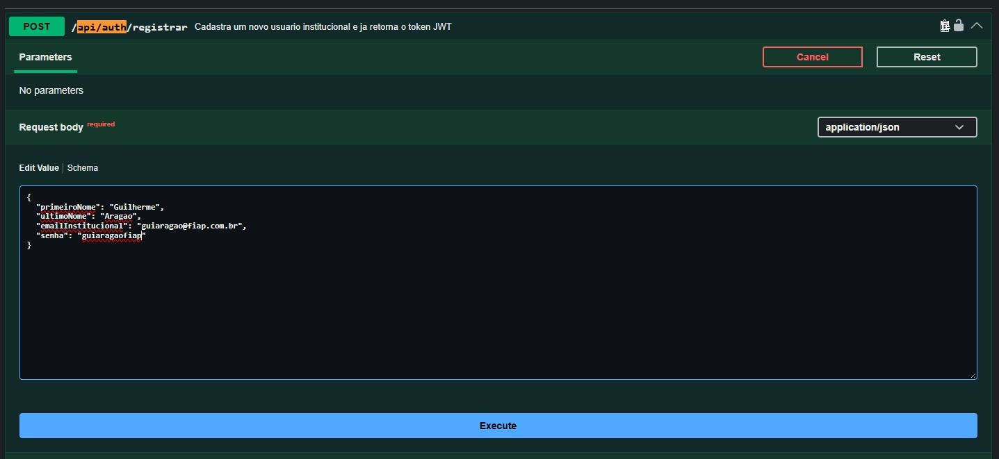

</details>

<details>
<summary><strong>Anexo 2 — HTTP 201 e token JWT</strong></summary>

A resposta do cadastro apresenta HTTP 201, token, tipo Bearer, expiração de 120 minutos e dados do usuário criado.

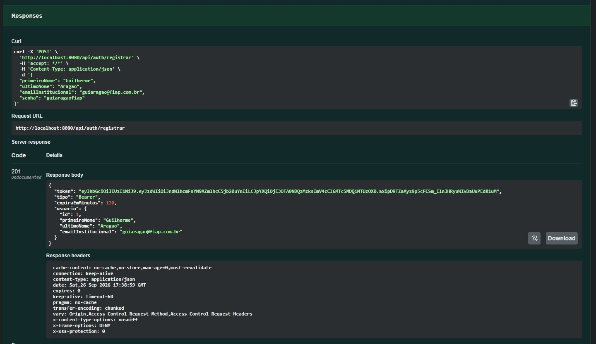

</details>

<details>
<summary><strong>Anexo 3 — Usuário no Oracle</strong></summary>

A consulta à tabela `USUARIOS` retorna o cadastro realizado pela API, com ID, nome, e-mail e data/hora de criação.

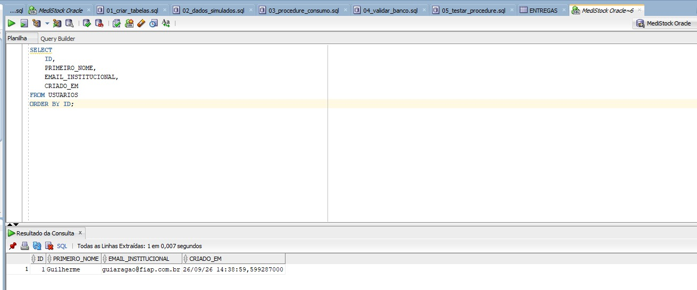

</details>

<details>
<summary><strong>Anexo 4 — Inserção do token no Swagger</strong></summary>

Janela de autorização `bearerAuth`, com o token no campo `Value`.

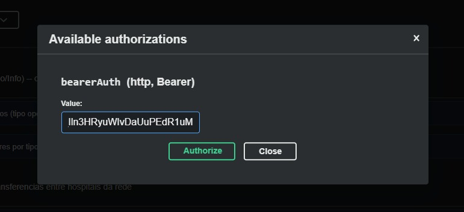

</details>

<details>
<summary><strong>Anexo 5 — Autorização confirmada</strong></summary>

O estado `Authorized` confirma a configuração do token no Swagger para as próximas requisições protegidas.

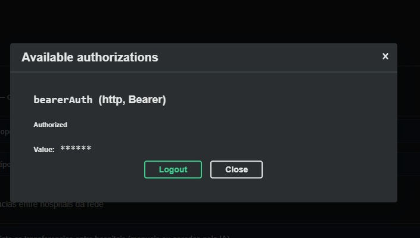

</details>

<details>
<summary><strong>Anexo 6 — Consulta autenticada de hospitais</strong></summary>

O GET `/api/hospitais` inclui o cabeçalho de autorização e retorna HTTP 200 com os hospitais da carga simulada.

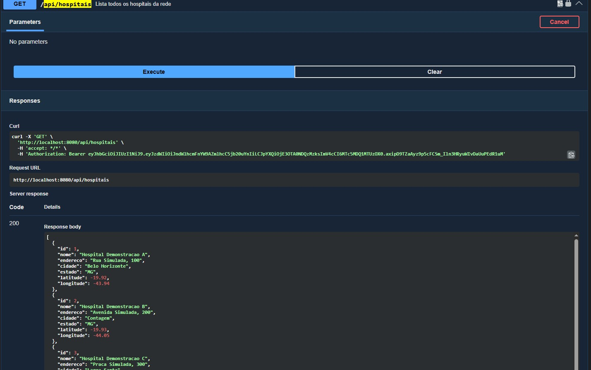

</details>

<details>
<summary><strong>Anexo 7 — Procedure inicial válida</strong></summary>

A consulta a `USER_OBJECTS` mostra `PR_REGISTRAR_CONSUMO` com status `VALID`. O print documenta a procedure independente da etapa inicial.

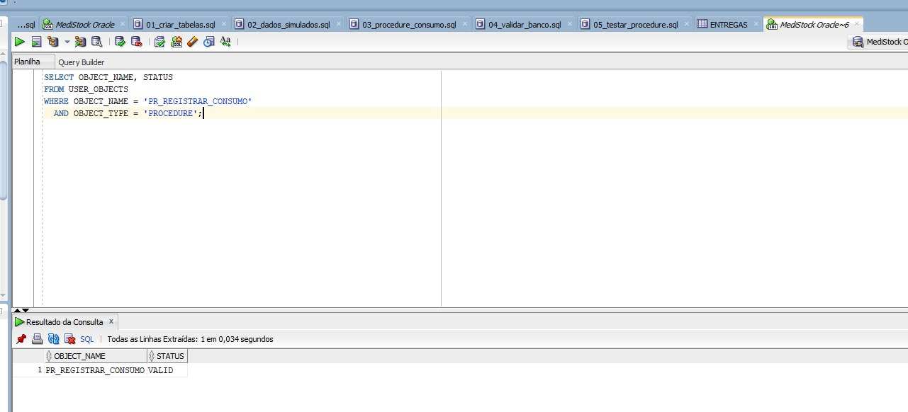

</details>

<details>
<summary><strong>Anexo 8 — Testes PL/SQL da primeira etapa</strong></summary>

A saída do arquivo `05_testar_procedure.sql` mostra inserção válida, rejeição de quantidade negativa, rejeição de hospital inexistente e rollback com preservação da contagem original.

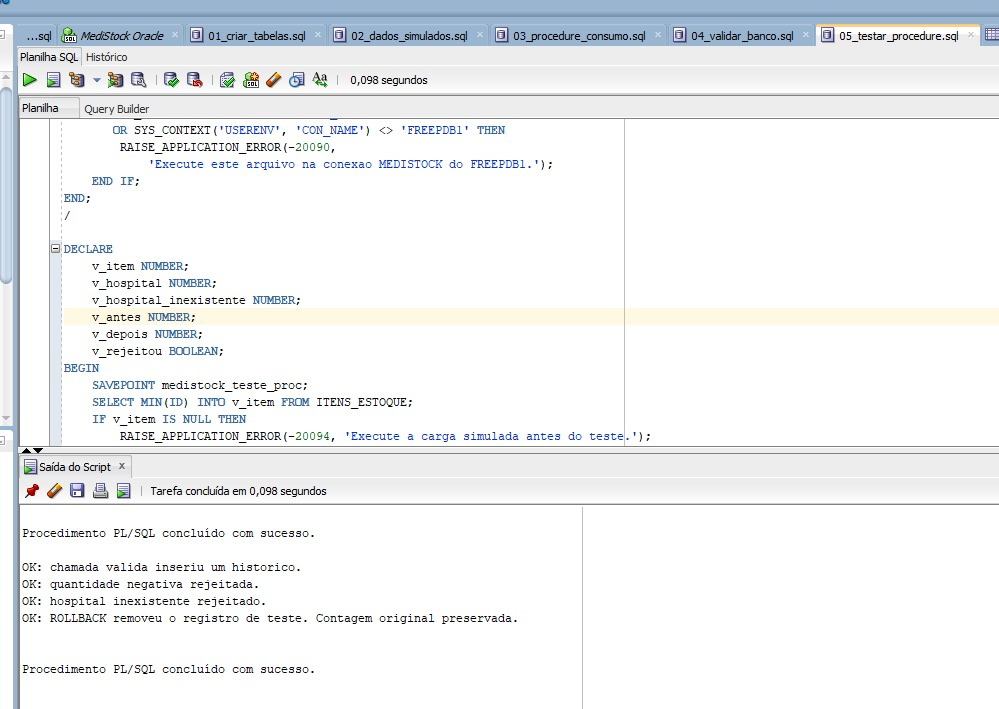

</details>

<details>
<summary><strong>Anexo 9 — Requisição de histórico de consumo</strong></summary>

Corpo do POST `/api/historico-consumo` com item `1`, hospital `1`, referência `2026-09` e quantidade `7`. A imagem mostra a preparação da requisição; os anexos seguintes mostram as consultas ao histórico.

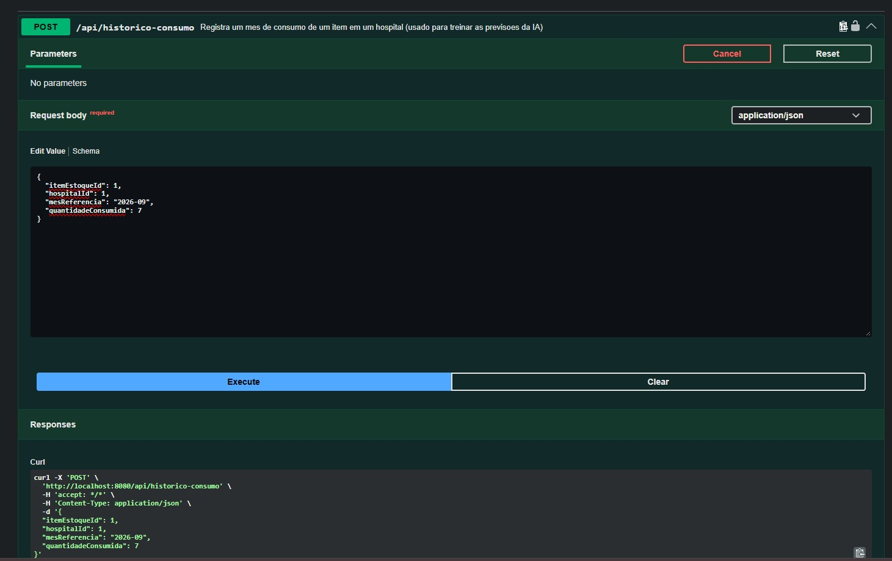

</details>

<details>
<summary><strong>Anexo 10 — Contagem anterior: 72 registros</strong></summary>

Resultado de `SELECT COUNT(*) AS TOTAL FROM HISTORICO_CONSUMO` antes da inclusão demonstrada.

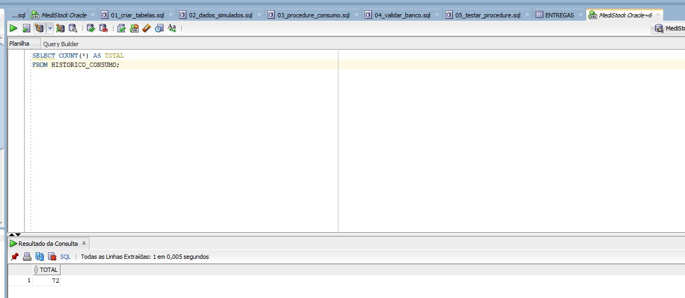

</details>

<details>
<summary><strong>Anexo 11 — Contagem posterior: 73 registros</strong></summary>

A mesma consulta apresenta uma linha adicional no histórico após a inclusão.

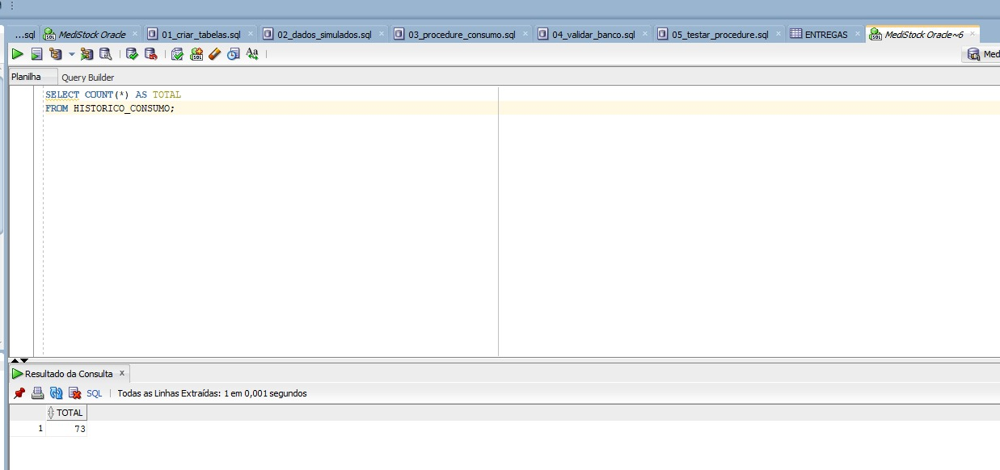

</details>

<details>
<summary><strong>Anexo 12 — Conferência do consumo persistido</strong></summary>

O registro mais recente exibido possui ID `221`, item `1`, hospital `1`, referência `2026-09-01` e quantidade consumida `7`. Esta captura comprova os valores de um consumo válido persistido; a rejeição de quantidade negativa está no anexo 8.

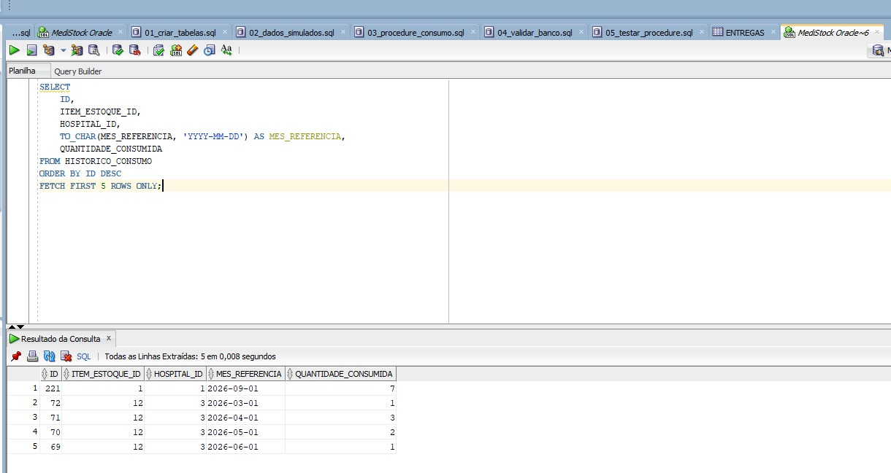

</details>

## 13. Diagnóstico rápido

| Situação | Verificação |
|---|---|
| `release version 25 not supported` | Confira `java`, `javac` e o JDK mostrado por `mvnw.cmd -version`. |
| Dependência Oracle não resolvida | Confira a versão do driver; depois de corrigir, use `mvnw.cmd -U -DskipTests package`. |
| Erro de serviço/SID ao conectar | Use nome de serviço `FREEPDB1`, host `localhost` e porta `1521`. |
| `ORA-01031` na criação da trigger | Execute `06` como `SYSTEM / FREEPDB1`. |
| `ORA-20090` | Confira o usuário e o container selecionados no SQL Developer. |
| `ORA-20091` ao repetir `07` | A tabela de auditoria já existe; confira o objeto existente pelo script `11`. |
| Package ou trigger `INVALID` | Consulte `USER_ERRORS` pelo script `11` e corrija o primeiro erro de compilação. |
| `ORA-04098` ao gravar consumo | Verifique a compilação da trigger e reexecute `10` após corrigir a causa. |
| Falha de contagem no script `12` | Confira se outra sessão ou a API estava gravando dados durante o teste. |
| Auditoria vazia depois do script `12` | O teste desfaz os próprios dados e logs. Use o roteiro do POST e do arquivo `14` para evidência persistida. |
| HTTP 401/403 em rota protegida | Faça login, autorize um token válido e confira o cabeçalho `Authorization`. |
| API sem registro de auditoria | Confira perfil `oracle`, schema utilizado, trigger habilitada e se a operação ocorreu após sua instalação. |
| `ORA-01017` | Confira a existência do usuário `MEDISTOCK` e a senha configurada no `.env`. |
| `ORA-12541` / `ORA-12514` | Confira se o banco e o serviço `FREEPDB1` estão disponíveis. Em uma instalação por Docker, confira também o container. |
| `missing table` ao iniciar | Confira a implantação das tabelas e o schema utilizado pela aplicação. |
| App no celular sem conexão | Confira IP do computador, rede Wi-Fi e liberação da porta 8080 no firewall. |

## 14. Documentação complementar

- [DER desta etapa](docs/DER_MediStock.png) e [fonte Mermaid](docs/DER_MediStock.mmd).
- [Catálogo dos objetos PL/SQL](docs/PLSQL_OBJETOS.md).
- [Scripts Oracle](database/oracle), com tipos, restrições e comentários de tabelas e colunas.
- [Implementação complementar de alertas](database/oracle/06_parte3_plsql.sql) e [exemplos](database/oracle/07_parte3_exemplos.sql).

## 15. Referências

- [Repositório MediStock_Back](https://github.com/luanaestanislau/MediStock_Back).
- [Oracle — PL/SQL Packages](https://docs.oracle.com/en/database/oracle/oracle-database/26/lnpls/plsql-packages.html).
- [Oracle — Native Dynamic SQL](https://docs.oracle.com/en/database/oracle/oracle-database/26/lnpls/native-dynamic-sql.html).
- [Oracle — CREATE TRIGGER](https://docs.oracle.com/en/database/oracle/oracle-database/26/lnpls/CREATE-TRIGGER-statement.html).
- [Oracle — Trigger Restrictions](https://docs.oracle.com/en/database/oracle/oracle-database/26/lnpls/trigger-restrictions.html).
- [Oracle — CREATE TABLE](https://docs.oracle.com/en/database/oracle/oracle-database/26/sqlrf/CREATE-TABLE.html).
- [Oracle — tipos de dados](https://docs.oracle.com/en/database/oracle/oracle-database/26/sqlrf/Data-Types.html).
- [Spring Boot — execução pelo Maven](https://docs.spring.io/spring-boot/maven-plugin/run.html).
- [Swagger — autenticação Bearer](https://swagger.io/docs/specification/v3_0/authentication/bearer-authentication/).
- [GitHub — README e caminhos relativos](https://docs.github.com/en/repositories/managing-your-repositorys-settings-and-features/customizing-your-repository/about-readmes).

## 16. Recursos complementares do repositório integrado

As orientações abaixo preservam os recursos de execução e API existentes na branch `main`, além da consolidação descrita nas seções anteriores. As evidências de setembro documentam a integração inicial; não comprovam os testes desses recursos complementares.

### 16.1 Execução com SQLite

Com o `.env` configurado e sem selecionar o perfil Oracle, o modo padrão utiliza `medistock.db` e cria as tabelas mapeadas pelo Hibernate:

```powershell
.\mvnw.cmd spring-boot:run
```

Se `SPRING_PROFILES_ACTIVE` estiver definido como `oracle`, ajuste a seleção de perfil para o modo desejado. As procedures, a trigger e os testes Oracle deste README exigem o perfil `oracle` e o banco Oracle. A chave JWT é necessária para a autenticação nos dois modos.

### 16.2 Oracle por Docker

O repositório também oferece a alternativa de executar Oracle em um container, para ambientes sem instalação local. O exemplo abaixo usa sintaxe PowerShell, com um volume persistente e a porta 1521:

```powershell
docker run -d --name oracle-medistock -p 1521:1521 -e ORACLE_PASSWORD=SUA_SENHA_ADMIN -v oracle-medistock-data:/opt/oracle/oradata gvenzl/oracle-free:slim-faststart
docker logs oracle-medistock
```

Substitua `SUA_SENHA_ADMIN` pela senha escolhida antes da execução e aguarde a mensagem `DATABASE IS READY TO USE!`. Em um computador que já tenha Oracle usando a porta 1521, escolha apenas uma instalação para essa porta ou ajuste o mapeamento e a conexão. A senha administrativa é distinta da senha definida para o schema `MEDISTOCK`.

Crie o usuário e execute os scripts pelo SQL Developer seguindo as conexões e sequências da seção 6. Também é possível copiar os scripts para o container com `docker cp database/oracle oracle-medistock:/tmp/oracle` e executá-los pelo SQL*Plus, usando as mesmas conexões e a ordem documentada. Nas próximas inicializações do container existente, use:

```powershell
docker start oracle-medistock
.\mvnw.cmd "-Dspring-boot.run.profiles=oracle" spring-boot:run
```

Em Bash, use `./mvnw` no lugar de `.\mvnw.cmd`. Uma alternativa para gerar a chave JWT em ambientes com OpenSSL é `openssl rand -base64 32`.

### 16.3 Acesso pelo aplicativo e rotas da API

O Swagger fica em `http://localhost:8080/docs` e a base dos endpoints em `http://localhost:8080/api`. No celular, use `http://IP_DO_COMPUTADOR:8080/api`, com os dispositivos na mesma rede e a porta 8080 acessível. As origens permitidas para clientes web podem ser configuradas em `CORS_ALLOWED_ORIGINS`, separadas por vírgulas.

| Rota base | Finalidade |
|---|---|
| `/api/auth` | Cadastro e login. |
| `/api/perfil` | Dados do usuário autenticado. |
| `/api/hospitais` | Cadastro, consulta e manutenção de hospitais. |
| `/api/estoque` | Itens e resumo do estoque. |
| `/api/alertas` | Alertas de estoque e validade. |
| `/api/historico-consumo` | Registro e consulta de consumo. |
| `/api/logistica` | Entregas, transferências e mapa. |
| `/api/ia` | Análise interna e sugestões de redistribuição. |
| `/api/plsql` | Alertas, indicadores e relatórios Oracle do módulo complementar. |

As rotas protegidas usam JWT; os contratos completos estão no Swagger. Configure `GEMINI_API_KEY` para utilizar os recursos dependentes da integração Gemini.

### 16.4 Módulo complementar de alertas e relatórios

O arquivo [06_parte3_plsql.sql](database/oracle/06_parte3_plsql.sql), executado como `MEDISTOCK / FREEPDB1` após as tabelas do domínio, cria:

| Objeto | Finalidade |
|---|---|
| `ALERTAS` | Persistir alertas associados a item e hospital. |
| `VW_ALERTAS_VIGENTES` | Consultar os alertas atuais que continuam coerentes com o estoque e a validade. |
| `FN_DIAS_COBERTURA_ESTOQUE` | Calcular cobertura a partir do saldo e do histórico de consumo. |
| `FN_STATUS_ESTOQUE_FORMATADO` | Retornar uma descrição da situação do estoque. |
| `PRC_REGISTRAR_ALERTAS_CRITICOS` | Processar e registrar alertas. |
| `PRC_RELATORIO_CONSUMO_HOSPITAL` | Gerar relatório de consumo por hospital. |

`ALERTAS` possui `ID`, `ITEM_ESTOQUE_ID`, `HOSPITAL_ID`, `TIPO`, `MENSAGEM`, `ORIGEM` e `CRIADO_EM`. O item e o hospital são FKs opcionais; a FK do item usa `ON DELETE CASCADE`. A tabela registra alertas de negócio, enquanto `AUDITORIA_CONSUMO` registra alterações do histórico.

O arquivo [07_parte3_exemplos.sql](database/oracle/07_parte3_exemplos.sql) demonstra as rotinas. No perfil Oracle, a aplicação expõe:

- `POST /api/plsql/alertas/processar`;
- `GET /api/plsql/alertas`;
- `GET /api/plsql/estoque/indicadores`;
- `GET /api/plsql/relatorios/consumo/{hospitalId}`.

Esses arquivos complementam `PKG_MEDISTOCK` e a trigger desta entrega. Seus nomes completos distinguem os scripts com prefixos numéricos iguais.

### 16.5 Testes automatizados Java

Para executar os testes Maven, sem a opção que os ignora:

```powershell
.\mvnw.cmd test
```

Os testes que dependem de Oracle real exigem a configuração do banco correspondente. A conciliação da documentação e dos conflitos Git não equivale à execução dessa suíte ou dos testes SQL no ambiente local.
